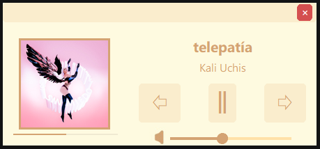
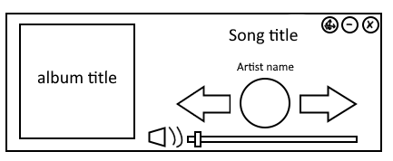

# Spotify Song Displayer
This project is a small desktop widget that shows the album cover, song title, artist and progress of the song youre listening to on spotiffy. The widget also allows for a play/pause button, skip, back/restart, and volume button too to allow for easy music control without having to open the app.

**This project was made BEFORE the Spotify API changes March 2026. This is an old personal project from 2025 that has not been updated since. It has only recently been pushed to a public repo.***

**Link to project:** https://github.com/sarahpilon/SpotifyMusicPlayer

<br>
*Final draft of the music player when project is used*


## How It's Made:

**Tech used:** Python, spotipy, customtkinter, tkinter, Pillow, python-dotenv

While talking to my friend, they shared how they had issues with the UI of the spotify GUI, and wanted access to control their music while doing hw and didn't want to open the app everytime. They also shared they had issues with the looks of the GUI, and wanted it to match their theme.

Knowing this, I decided to draft up a design they approved of, and make a mini player that sits on top of other windows and is easily moveable. 


<br>
*Above is the initial draft of the music player before figuring out a color theme*

## How to Run:
 
1. Install the dependencies:
```bash
   pip install spotipy customtkinter pillow certifi python-dotenv
```
2. Create an app in the [Spotify Developer Dashboard](https://developer.spotify.com/dashboard) and add a redirect URI that matches the one in your `.env` file. Playback control requires a Spotify Premium account.
3. Create a `.env` file in the project folder:
```dotenv
   SPOTIPY_CLIENT_ID=your-client-id
   SPOTIPY_CLIENT_SECRET=your-client-secret
   SPOTIPY_REDIRECT_URI=https://example.com/callback
```
4. Make sure `cute_theme.json` and `Volume.jpg` are in the same folder as `MusicPlayer.py`.
5. Start playing a song in Spotify, then run:
```bash
   python MusicPlayer.py
```
6. On the first run, a browser window opens asking you to approve the app. After approving, copy the full URL you're redirected to and paste it into the terminal.
Your login is saved in a `.cache` file, which is listed in `.gitignore` so your tokens never get committed.
 
## Optimizations

- **Dynamic text sizing:** Song titles and artist names sometimes end up being too long for the widget, so the font starts at its default size and shrinks when the text ends up overflowing. If it still doesn't fit at the minimum size, it's truncated with an ellipsis.

- **Multi-use button:** The back button restarts the song, while also allowing you to go back a song depending on the position of the current song you are in is at. 


